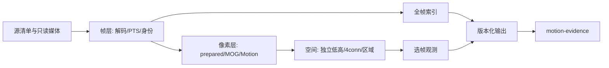

# 架构

## 三层边界

- 帧层拥有源文件、解码器和真实时间身份。
- 像素层接收帧；模型学习不接收AI反馈或最终时间线。
- 外层负责顺序、计数、状态、协议及资源记录。

CPU reference在一个进程中顺序执行。原生GPU路线使用独立进程隔离私有OpenCV/系统FFmpeg与Python wheel ABI。应用帧租约和decoder DPB不是同一个预算。

按需人物推理由独立OpenCV DNN/OpenCL进程执行，保持原像素worker的媒体ABI隔离。第一步保留原BGR/blob预处理和CPU后处理，仅把网络前向交GPU；不能将其描述为人物图像全链零拷贝。逐层执行位置和GPU执行证据属于验收项。

## 输出提交

完成前写私有运行目录。只有索引、观测和源清单完成并计算指纹后，`status.json`才成为`complete`。缺少输入写hold；异常退出没有complete承诺。

## 协同

两个项目共享文件协议版本，不互相导入Python代码。源清单与帧ID稳定，证据项目可自行按PTS读取原图。联调依赖合成输入和协议测试，不依赖某台机器的目录结构。
