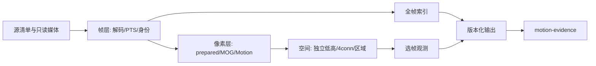

# 架构

## 三层边界

- 帧层拥有源文件、解码器和真实时间身份。
- 像素层接收帧；模型学习不接收AI反馈或最终时间线。
- 外层负责顺序、计数、状态、协议及资源记录。

CPU reference在一个进程中顺序执行。原生GPU路线使用独立进程隔离私有OpenCV/系统FFmpeg与Python wheel ABI。应用帧租约和decoder DPB不是同一个预算。

按需人物推理由独立OpenCV DNN/OpenCL进程执行，保持原像素worker的媒体ABI隔离。第一步保留原BGR/blob预处理和CPU后处理，仅把网络前向交GPU；不能将其描述为人物图像全链零拷贝。逐层执行位置和GPU执行证据属于验收项。

## Python模块职责

以下模块位于`motion_detect`包内。CLI命令与文件协议独立于内部模块名。

| 模块 | 职责 |
|---|---|
| `cli` | 构建命令解析器、校验参数并调度，不实现媒体处理。 |
| `pipeline` / `core` | CPU解码、选帧和索引输出编排 / reference像素算法。 |
| `artifacts` | 版本化JSON/JSONL、文件指纹和hold状态输出。 |
| `native_pipeline` | 校验源与构建清单，准备配置并启动隔离进程。 |
| `native_worker` | 原生解码和像素处理，输出观测、模型轨迹、资源与完成状态；不导入Python cv2/av。 |
| `native_build` | 在显式外部目录构建原生绑定并记录构建清单。 |
| `person_client` / `person_worker` / `person_gpu` | 候选硬门控和按需IPC / 人检进程协议 / GPU DNN实现。 |

## 输出提交

完成前写私有运行目录。只有索引、观测和源清单完成并计算指纹后，`status.json`才成为`complete`。缺少输入写hold；异常退出没有complete承诺。

## 协同

两个项目共享文件协议版本，不互相导入Python代码。源清单与帧ID稳定，证据项目可自行按PTS读取原图。联调依赖合成输入和协议测试，不依赖某台机器的目录结构。
